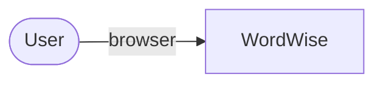
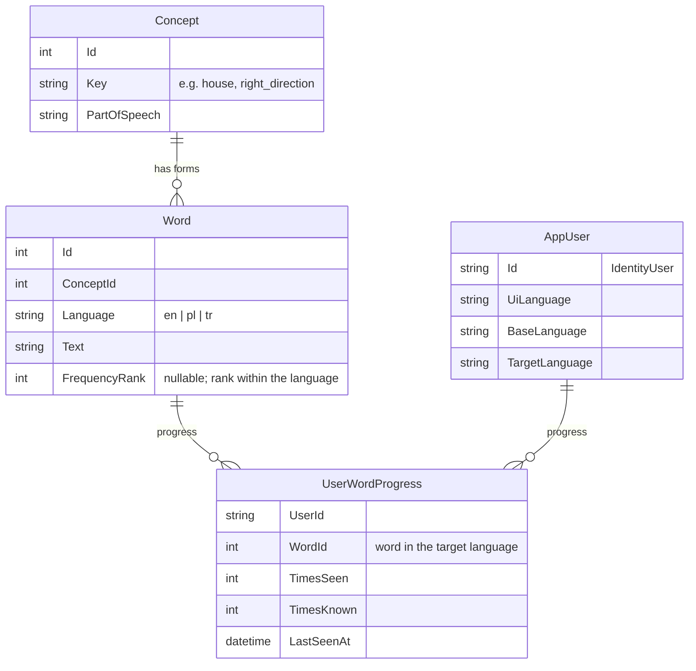

# Architecture

Lightweight arc42 + C4 diagrams (https://c4model.com). Detailed decisions are in `adr/`.

## Context (C4 level 1)

No external systems in the MVP.

## Containers (C4 level 2)

In dev, Angular (`:4200`) proxies `/api` to the API (`:5033`). This way the SPA and the API are a single origin from the browser's point of view (ADR-0004).

## Backend: vertical slices (ADR-0002)
Code is organized by feature (`Features/Words`, `Features/Study`, `Features/Account`), not by technical layer. Each slice contains the controller, DTOs and use-case logic. Only `Domain/` (entities) and `Infrastructure/` (DbContext) are shared.

## Data model (ADR-0005)

- Uniqueness: `Word(ConceptId, Language, Text)`, `Concept(Key)`, `UserWordProgress(UserId, WordId)`.
- Study session (base B → target T): words with `Language = T` that have a rank, sorted by rank or randomly; translations are words with `Language = B` sharing the same `ConceptId`.
- Progress is tracked per target word and shared across all base languages.

## Quality and cross-cutting concerns
- API errors: `ProblemDetails` (RFC 9457).
- Contract: OpenAPI (`/openapi/v1.json`, also written to `src/web/openapi/` at build time) is the source of truth; the Angular client (models + `HttpClient` functions) is generated from it with ng-openapi-gen (ADR-0012).
- UI components: spartan/ui (brain primitives + helm components in `shared/ui/`), theme in CSS variables (ADR-0011). Mobile first.
- UI i18n: Transloco (ADR-0006). Content (words) comes from the API.

## Authentication: framework plan (ADR-0004)
The high-level plan for accounts and sign-in. Details, rules and tasks go into spec 002 (`/spec-feature`); this section fixes the shape so later specs (study session, progress) can rely on it.

### Phases
| Phase | Scope | Spec |
|---|---|---|
| A1 | Register, sign in, sign out, "who am I", language preferences. Cookie session. | 002 |
| A2 | Protecting user data: progress endpoints require sign-in, `UserId` always from the cookie, never from the request. | 003 |
| A3 | Email confirmation and password reset (needs an `IEmailSender`; dev: log to console or a local mail catcher). | backlog |
| A4 | Before deployment: HTTPS-only cookie, CSRF review (antiforgery), rate limiting on `/api/auth/login`, account deletion. | backlog |
| A5 | Optional: external sign-in (Google), 2FA (the Identity API already has `/manage/2fa`). | backlog |

### Backend (A1)
- `AppUser : IdentityUser` with `UiLanguage`, `BaseLanguage`, `TargetLanguage`; `WordWiseDbContext : IdentityDbContext<AppUser>` + migration `AddIdentity`.
- DI: `AddIdentityApiEndpoints<AppUser>()` + `AddEntityFrameworkStores<WordWiseDbContext>()`; `AddAuthorization()`.
- Endpoints (slice `Features/Account`):

  | Method | Path | Source | Auth |
  |---|---|---|---|
  | POST | `/api/auth/register` | `MapIdentityApi<AppUser>()` in a `/api/auth` group | anonymous |
  | POST | `/api/auth/login?useCookies=true` | `MapIdentityApi` | anonymous |
  | POST | `/api/auth/logout` | custom: `SignInManager.SignOutAsync()` (the Identity API has no logout) | signed in |
  | GET | `/api/account/me` | custom: email + language preferences | signed in |
  | PUT | `/api/account/preferences` | custom: validation `base ≠ target`, codes ∈ {en, pl, tr} | signed in |

  Unused built-in endpoints (`/refresh`, bearer tokens) stay off the contract or are documented as unused.
- Cookie: HttpOnly (default), `SameSite=Lax`, `SecurePolicy=Always` outside Development, sliding expiration.
- 401/403 instead of a redirect: the default in .NET 10 for `[ApiController]` endpoints, so no custom events are needed. An integration test confirms it.
- Identity options per `docs/conventions/security.md` (NIST SP 800-63B-4): min. 15 characters, no composition rules, blocklist of common/breached passwords; lockout after failed attempts; unique email.
- Authorization: `[Authorize]` on the controllers that need a user. Proposal for spec 002: the word catalog (`/api/words/cards`) stays anonymous, progress requires sign-in.

### Frontend (A1)
- `core/auth/`: `AuthService` with a `currentUser` signal (`null` = signed out) and a `isSignedIn` computed; the state is loaded once at startup from `GET /api/account/me` (`provideAppInitializer`). 401 = signed out, not an error.
- Functional `authGuard` (`CanActivateFn`) on protected routes → redirect to `/login?returnUrl=…`.
- Functional HTTP interceptor: a 401 from the API clears `currentUser` and redirects to `/login`. Same origin, so the cookie is sent without `withCredentials`.
- Pages `features/account/`: `login`, `register` (forms with validation), language preferences. Identity error codes (e.g. `PasswordTooShort`, `DuplicateUserName`) map to Transloco keys `account.errors.<code>` in 3 languages.
- After sign-in the UI language switches to `UiLanguage` from the profile (ADR-0006).

### Tests (A1)
- Backend unit: preference validation (language pair), mapping `AppUser` → `MeResponse`.
- Backend integration (`WebApplicationFactory<Program>`): register → login → `me` returns the email; `me` without a cookie → 401; logout → the next `me` → 401; duplicate email → 400 ValidationProblem. These need a real database: Testcontainers (backlog item moves forward to spec 002) or a decision recorded in the spec.
- Frontend (Vitest): `AuthService` with `HttpTestingController`, the guard (signed in / signed out), the interceptor (401 → redirect), the login form (validation messages, submit).

### Open questions (for spec 002)
- Testcontainers now vs. a separate test database from `compose.yaml`.
- Sign-in required for the whole app or only for study/progress (proposal above: only progress).
- Should registration ask for the language pair right away, or should it get defaults (`UiLanguage` from the browser, pair chosen later)?

### Learning resources
- Identity for SPAs (endpoints, logout): https://learn.microsoft.com/aspnet/core/security/authentication/identity-api-authorization
- 401/403 instead of redirects in .NET 10: https://learn.microsoft.com/aspnet/core/security/authentication/api-endpoint-auth
- Route guards: https://angular.dev/guide/routing/route-guards
- HTTP interceptors: https://angular.dev/guide/http/interceptors
