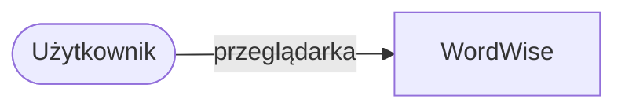
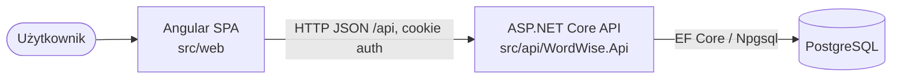
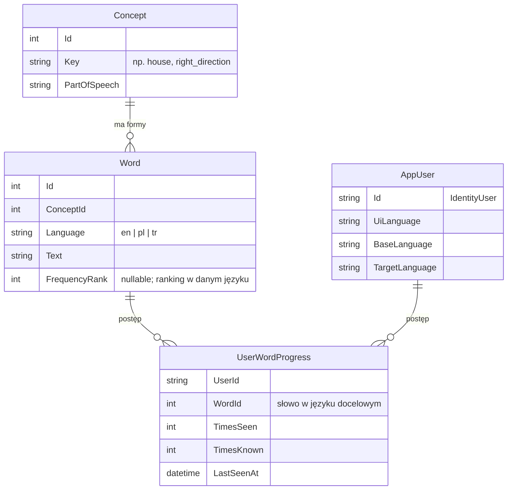

# Architektura

Lekki arc42 + diagramy C4 (https://c4model.com). Decyzje szczegółowe są w `adr/`.

## Kontekst (C4 poziom 1)

Brak systemów zewnętrznych w MVP.

## Kontenery (C4 poziom 2)

W dev Angular (`:4200`) przekazuje `/api` przez proxy do API (`:5033`). Dzięki temu SPA i API są dla przeglądarki jednym originem (ADR-0004).

## Backend: vertical slices (ADR-0002)
Kod zorganizowany wg funkcji (`Features/Words`, `Features/Study`, `Features/Account`), a nie wg warstw technicznych. Każdy slice zawiera kontroler, DTO i logikę przypadku użycia. Wspólne są tylko `Domain/` (encje) i `Infrastructure/` (DbContext).

## Model danych (ADR-0005)

- Unikalność: `Word(ConceptId, Language, Text)`, `Concept(Key)`, `UserWordProgress(UserId, WordId)`.
- Sesja nauki (bazowy B → docelowy T): słowa `Language = T` z rankiem, sortowane po ranku lub losowo; tłumaczenia to słowa `Language = B` o tym samym `ConceptId`.
- Postęp jest per słowo docelowe, wspólny dla wszystkich języków bazowych.

## Jakość i przekroje
- Błędy API: `ProblemDetails` (RFC 9457).
- Kontrakt: OpenAPI (`/openapi/v1.json`) jako źródło prawdy dla DTO w TS.
- i18n UI: Transloco (ADR-0006). Treść (słowa) przychodzi z API.
