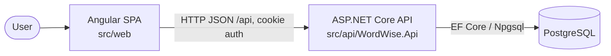
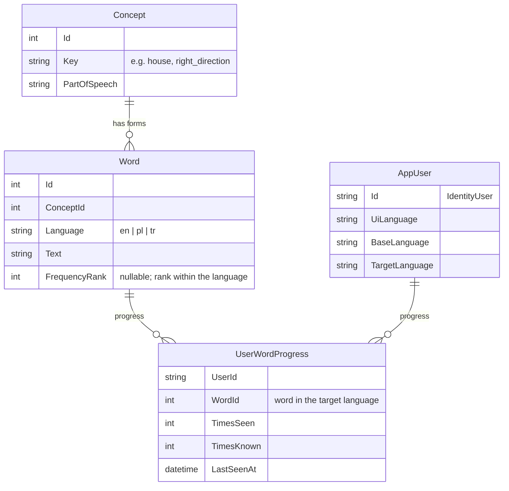

# Architecture

Lightweight arc42 + C4 diagrams (https://c4model.com). Detailed decisions are in `adr/`.

## Context (C4 level 1)

No external systems in the MVP.

## Containers (C4 level 2)

In dev, Angular (`:4200`) proxies `/api` to the API (`:5033`). This way the SPA and the API are a single origin from the browser's point of view (ADR-0004).

## Backend: vertical slices (ADR-0002)
Code is organized by feature (`Features/Words`, `Features/Study`, `Features/Account`), not by technical layer. Each slice contains the controller, DTOs and use-case logic. Only `Domain/` (entities) and `Infrastructure/` (DbContext) are shared.

## Data model (ADR-0005)

- Uniqueness: `Word(ConceptId, Language, Text)`, `Concept(Key)`, `UserWordProgress(UserId, WordId)`.
- Study session (base B → target T): words with `Language = T` that have a rank, sorted by rank or randomly; translations are words with `Language = B` sharing the same `ConceptId`.
- Progress is tracked per target word and shared across all base languages.

## Quality and cross-cutting concerns
- API errors: `ProblemDetails` (RFC 9457).
- Contract: OpenAPI (`/openapi/v1.json`) as the source of truth for TS DTOs.
- UI i18n: Transloco (ADR-0006). Content (words) comes from the API.
